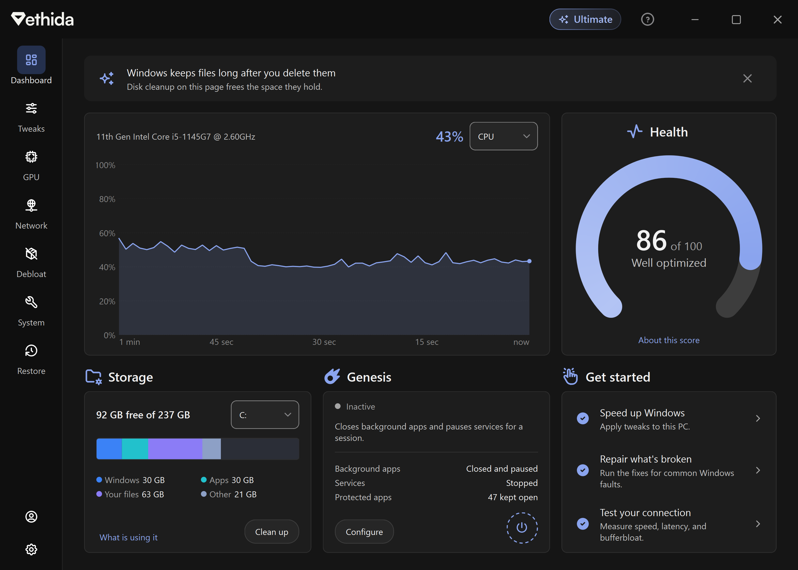

# Vethida

A Windows optimization tool. Qt 6, C++20, MSVC.



Decided to open-source Vethida because im moving onto linux stuff for the foreseeable future :/

This is an archive, not a maintained project.

## Getting it

Builds from this repo have everything unlocked, every Pro and Ultimate feature, with no license key and no account.

Early access tweaks are still off until you turn them on in Settings.

## Building

Windows, Visual Studio 2026 with the C++ workload and the Qt Visual Studio Tools extension, and Qt 6.12 for MSVC 2022 64-bit. Visual Studio 2022 works too if you add `/p:PlatformToolset=v143`.

```
msbuild Vethida/vethida.sln /p:Configuration=Release /p:Platform=x64 /p:QtInstall=<path to Qt>
```

A Release build needs an update-signing key first: run `node vethida.com/scripts/appcast.mjs keys` and put the public key it prints in `kEdDsaPublicKey` (`vth_core/Runtime/AutoUpdate.h`). Debug builds don't.

`.github/workflows/build.yml` does the same thing on every push, so it's the reference if something doesn't build.

## Turning it back into a paid product

Licensing is still all there, just compiled out. Add `/p:VethidaLicensing=true` to the build and you get the licensed version back: Free, Pro and Ultimate tiers, license keys, the Account page and upgrade prompts. Tiers are worked out per tweak in `vth_core/Tweaks/TweakEngine.cpp`, and the gate is `vth_core/Runtime/Tier.cpp`.

A licensed build checks keys against a licensing API, `kApiBase` in `vth_core/Services/LicenseApi.h`. The one Vethida used is in `api/` (Node, SQLite and Stripe). Point `kApiBase` at your own deployment.

## Use at your own risk

Vethida changes Windows settings, services, drivers and in some cases firmware. Some tweaks can make a PC unstable, less secure or stop it booting. Read what a tweak does before applying it, and make a restore point first (the Restore page does that).

I hold no responsibility for anything that happens to your PC, your data or anything else from using Vethida, from this repo or any build of it. You use it entirely at your own risk.
## License

MIT, see [LICENSE](LICENSE). Third-party components are listed in [THIRD_PARTY_NOTICES.txt](THIRD_PARTY_NOTICES.txt).
