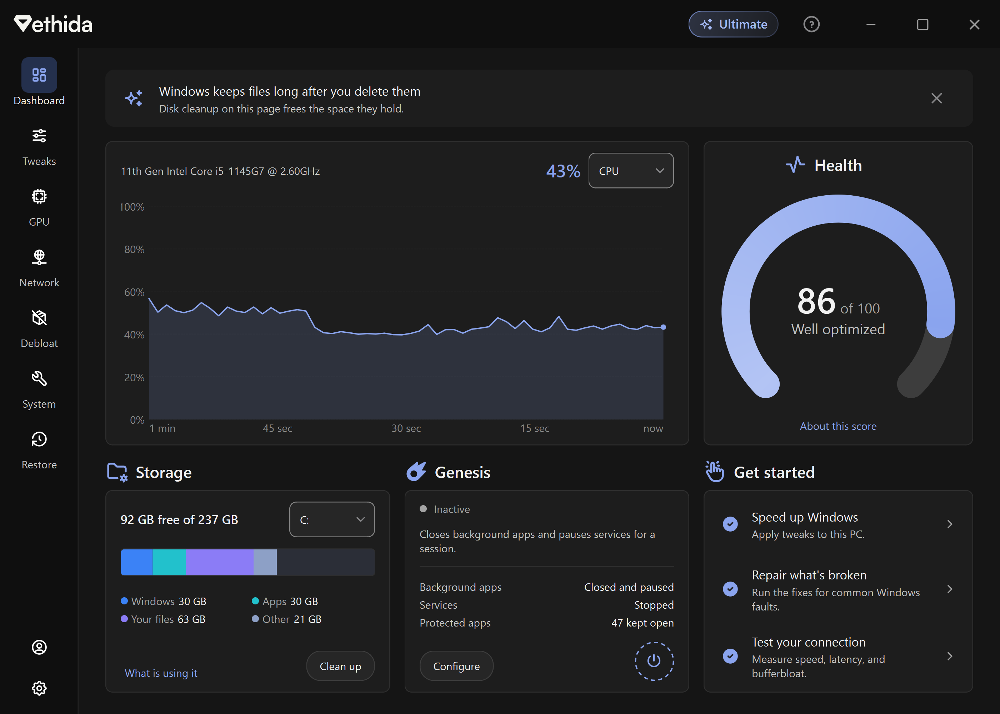

# Vethida

A Windows optimization tool. Qt 6, C++20, MSVC.



Decided to open-source Vethida because im moving onto linux stuff for the foreseeable future :/

This is an archive, not a maintained project.

## Download

Get the zip from the latest [release](../../releases/latest) and run `Vethida.exe` as admin. Everything is unlocked, no license key or account needed.

It isn't signed, so SmartScreen will warn: More info, then Run anyway.

Early access tweaks are off until you enable them in Settings.

## Antivirus

Some engines flag Vethida because it edits the registry, services and scheduled tasks and isn't signed. Check the file's hash (`Get-FileHash .\Vethida.exe`) on [VirusTotal](https://www.virustotal.com), or build it yourself.

To report a false positive to Microsoft, use the [file submission page](https://www.microsoft.com/en-us/wdsi/filesubmission).

## Building

Visual Studio 2026 with the C++ workload and Qt VS Tools, and Qt 6.12 for MSVC 2022 64-bit. For Visual Studio 2022, add `/p:PlatformToolset=v143`.

```
msbuild Vethida/vethida.sln /p:Configuration=Release /p:Platform=x64 /p:QtInstall=<path to Qt>
```

Release builds need an update signing key: run `node vethida.com/scripts/appcast.mjs keys` and put the public key in `kEdDsaPublicKey` (`vth_core/Runtime/AutoUpdate.h`).

See `.github/workflows/build.yml` for the CI build.

## Licensing

Licensing is compiled out by default. Build with `/p:VethidaLicensing=true` to get the Free, Pro and Ultimate tiers, license keys and the Account page back. Tiers are set in `vth_core/Tweaks/TweakEngine.cpp`, gated in `vth_core/Runtime/Tier.cpp`.

Licensed builds check keys against `kApiBase` in `vth_core/Services/LicenseApi.h`. The API is in `api/`.

## Disclaimer

Vethida changes Windows settings, services, drivers and firmware. Some tweaks can make a PC unstable, less secure or unbootable. Make a restore point first.

Use at your own risk. I'm not responsible for anything that happens from using it.

## License

MIT, see [LICENSE](LICENSE). Third-party components are listed in [THIRD_PARTY_NOTICES.txt](THIRD_PARTY_NOTICES.txt).
